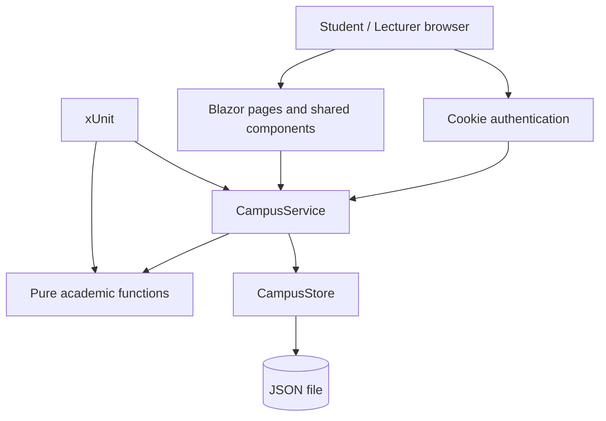
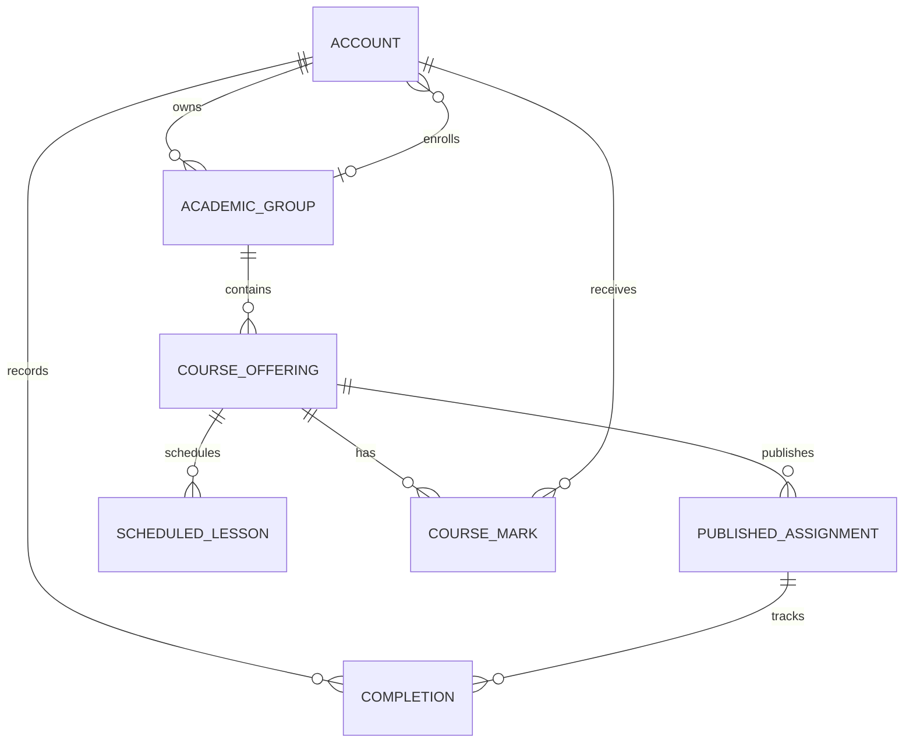

# Project and defense notes

Nurlybek Yesbolganov · Amir Oshanbay · IT-2507

Astana IT University · Introduction to Functional Programming · 2026

## Topic, aim and objectives
StudentHub — Functional Academic Management System. Aim: help students and lecturers organize courses, assignments, grades and weekly lessons. Objectives: centralized group data, GPA calculation, task prioritization, schedule conflict detection, role-based access and functional programming.

## Technology comparison
- Console C#: portable but limited graphical usability.
- WPF: desktop UI, Windows-oriented.
- Blazor Interactive Server: C# components and responsive browser interface; requires a running server.
- Blazor WebAssembly: browser execution; larger initial download and different persistence model.
- JSON: built-in serialization, no database installation, appropriate for a small local demonstration. Relationships are checked by service code.
- SQLite/EF Core or PostgreSQL: suitable for larger datasets and database-enforced constraints but require additional packages or infrastructure.

## Architecture

Functional Core / Imperative Shell. Core records and ImmutableArray represent snapshots. Changes validates and returns new data. CampusService authorizes operations, maps stored entities to immutable snapshots and validates changes. CampusStore copies the previous snapshot and saves a new one only after successful validation. The service enforces unique emails, group/course names, ownership and references. Passwords are hashed, and cookie authentication identifies the current user; the service checks ownership before writes.

## Logical data model (stored in JSON)

## Functional programming examples
- Pure functions: GradePoints, Gpa, Priority, Overlaps, RequiredFinal.
- Immutability: Course, Assignment, Lesson and HubData records; with expressions.
- Higher-order functions: Filter(predicate, search), CampusService.Write(delegate).
- Currying: Priority takes date and assignment; Curry fixes today to generate a ranking function.
- Composition: Filter composes title extraction and normalization.
- Map / Bind: Map transforms success; Bind chains Result-returning functions; both propagate errors.
- LINQ: Where, Select, Sum, GroupBy, OrderBy.
- Pattern matching: grade thresholds, AssignmentStatus and Ok/Fail.
- Side effects: file writes and authentication are outside the functional core.

## Suggested presentation outline
1. Team members (Nurlybek Yesbolganov and Amir Oshanbay, IT-2507), topic, aim and objectives.
2. Problem and practical significance.
3. Technology comparison and reasons for choices.
4. Architecture and logical data diagram.
5. Development methodology and app mockups/screenshots.
6. Functional programming examples.
7. Live demo: lecturer creates group and task; student joins and completes task; lecturer enters grade; student views GPA.
8. Validation and test results (only claim tests actually run).
9. Known limitations and future work.

Both students must contribute code, review the implementation and be ready to explain any part of the project. Do not claim contributions or test results that did not happen.
