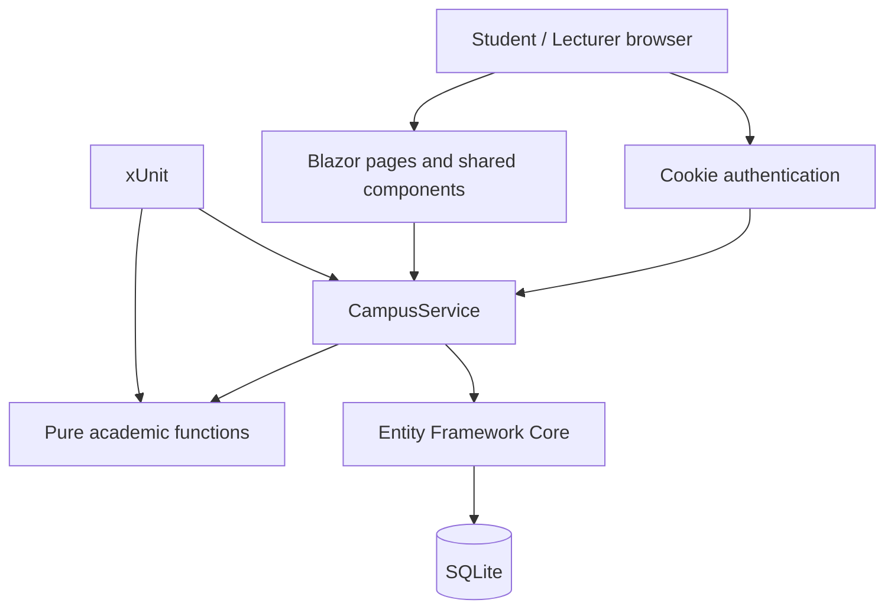
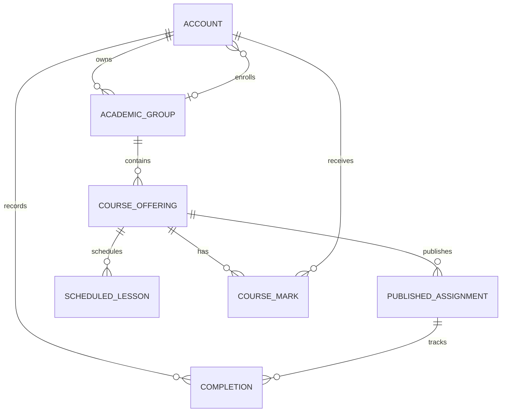

# Project and defense notes

## Topic, aim and objectives
StudentHub — Functional Academic Management System. Aim: help students and lecturers organize courses, assignments, grades and weekly lessons. Objectives: centralized group data, GPA calculation, task prioritization, schedule conflict detection, role-based access and functional programming.

## Technology comparison
- Console C#: portable but limited graphical usability.
- WPF: desktop UI, Windows-oriented.
- Blazor Interactive Server: C# components and responsive browser interface; requires a running server.
- Blazor WebAssembly: browser execution; larger initial download and different persistence model.
- JSON: convenient for a single-user prototype, but difficult to enforce relationships.
- SQLite and EF Core: local relational database, no separate database server, constraints and transactions. PostgreSQL is a future option for a larger deployment.

## Architecture

Functional Core / Imperative Shell. Core records and ImmutableArray represent snapshots. Changes validates and returns new data. CampusService authorizes operations, maps rows to immutable snapshots and commits validated database changes. The DB enforces unique keys, references and composite keys for grades and completion. Passwords are hashed, and cookie authentication identifies the current user; the service checks ownership before writes.

## Data model

## Functional programming examples
- Pure functions: GradePoints, Gpa, Priority, Overlaps, RequiredFinal.
- Immutability: Course, Assignment, Lesson and HubData records; with expressions.
- Higher-order functions: Filter(predicate, search), CampusService.Write(delegate).
- Currying: Priority takes date and assignment; Curry fixes today to generate a ranking function.
- Composition: Filter composes title extraction and normalization.
- Map / Bind: Map transforms success; Bind chains Result-returning functions; both propagate errors.
- LINQ: Where, Select, Sum, GroupBy, OrderBy.
- Pattern matching: grade thresholds, AssignmentStatus and Ok/Fail.
- Side effects: database transactions and authentication are outside the functional core.

## Suggested presentation outline
1. Team members (both real names), topic, aim and objectives.
2. Problem and practical significance.
3. Technology comparison and reasons for choices.
4. Architecture and database diagram.
5. Development methodology and app mockups/screenshots.
6. Functional programming examples.
7. Live demo: lecturer creates group and task; student joins and completes task; lecturer enters grade; student views GPA.
8. Validation and test results (only claim tests actually run).
9. Known limitations and future work.

Both students must contribute code, review the implementation and be ready to explain any part of the project. Do not claim contributions or test results that did not happen.
