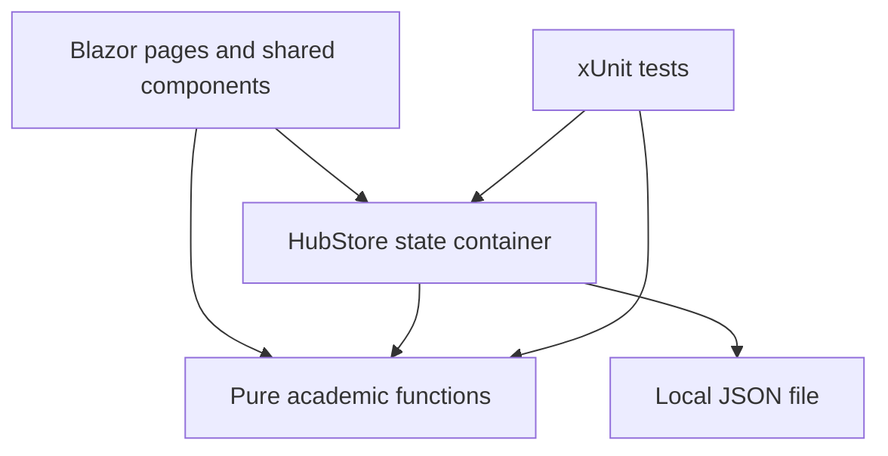

# Project and defense notes

## Topic, aim and objectives
StudentHub — Functional Academic Management System. Aim: help students organize deadlines, courses and weekly lessons. Objectives: centralize data, calculate GPA, prioritize assignments, prevent scheduling conflicts and demonstrate functional programming.

## Technology comparison
- Console C#: simple and portable, but limited graphical usability.
- WPF: desktop interface, Windows-oriented.
- Blazor Interactive Server: C# components and web-based UI, responsive across browsers; requires a running server.
- Blazor WebAssembly: runs .NET in the browser; more start-up overhead and requires a different persistence approach.
- JSON: no database setup, small local workload; no multi-user transactions or querying indexes. SQLite/PostgreSQL would be a future improvement.

## Architecture
Functional Core / Imperative Shell:

The core uses records and ImmutableArray. Changes returns a new HubData value instead of modifying existing records. The store locks updates and writes a temporary file before replacing the saved file. Failed writes leave the in-memory snapshot unchanged. UI passes delegates and receives Result values.

## Functional programming examples
- Pure functions: GradePoints, Gpa, Priority, Overlaps. Same inputs produce same outputs.
- Immutability: Course, Assignment, Lesson and HubData records; with expressions.
- Higher-order functions: Filter(predicate, search), HubStore.Change(delegate).
- Currying: Priority takes date and task; Curry fixes today's date and produces a ranking function.
- Composition: Filter composes title extraction and uppercase normalization.
- Map versus Bind: Map transforms success; Bind chains operations that return another Result. Both propagate failure without calling the next function.
- LINQ: Where, Select, Sum, OrderBy, Grouping-like per-course projection.
- Pattern matching: grade thresholds, AssignmentStatus and Ok/Fail.

## Suggested presentation outline
1. Team members (add both real names), topic, aim and objectives.
2. Problem and practical significance.
3. Technology comparison and reasons for choices.
4. Architecture and functional programming concepts.
5. Screens or mockups showing the main pages.
6. Live demo: course creation, invalid grade, assignment sorting, completion, timetable conflict, GPA.
7. Test cases, known limitations, future work.

## Defense questions
- Why use immutable records? Safer state updates and predictable tests.
- Why pass today instead of reading it inside Priority? Keeps logic deterministic.
- How is GPA weighted? Sum of grade points times credits / graded credits.
- Why use Result instead of exceptions for validation? Expected failure becomes explicit data.
- Why is persistence imperative? It changes disk state and can fail for environmental reasons.
- Why does a lesson ending at 10:00 not conflict with one starting at 10:00? Ranges use strict overlap comparisons.

Both students should make actual code changes, review each other's work and understand the entire application. Document the work each person actually completed; do not claim contributions that were not made.
